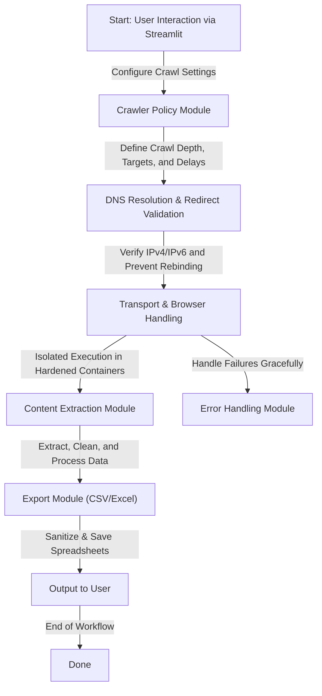

# my_crawler

  
  
  
  
  

---

## Executive Summary

**my_crawler** is an advanced, secure, and modular web crawler built for safe and legal data extraction from target websites. It combines robust technical safeguards, DNS validation, containerized execution environments, and adversarial protections to address modern web crawling threats like SSRF, DNS rebinding, and resource exhaustion.

---

## Key Features

- **Adversarial Protections**: Mitigates risks like SSRF, DNS rebinding, DNS spoofing, and hostile content injection through real-time DNS resolution and redirect validation.
- **Hardened Browser Isolation**: Executes browser workers in sandboxed containers with:
  - No internal network routes
  - Non-root execution
  - Read-only filesystems and tightly controlled resources
- **Rate Limiting & Concurrency Controls**: Enforces per-target crawl delays and maximum concurrent connections.
- **Export Security**: Prevents spreadsheet attacks by sanitizing exported CSV/Excel files to handle formula-based injections (`=`, `+`, `@`, etc.).
- **Configurable Crawl Policies**: Modular design separates policy definitions, transport logic, browser execution, content extraction, and data export, ensuring highly testable and reusable components.
- **Streamlined Testing**: Integrated pytest suite covering boundary cases, including handling of redirects, depth limits, and fail-safe execution.
- **Compliance and Safety**: Documents ethical crawling practices while ensuring operational policies are programmable beyond the standard `robots.txt` mechanism.

---

## Architecture & Workflow



---

## Tech Stack & Tools Breakdown

- **Programming Language**: Python 3.9+
- **User Interface**: Streamlit for intuitive configuration and progress tracking
- **Web Crawling**: Selenium (browser automation) and BeautifulSoup4 (HTML parsing)
- **Data Handling**: Pandas for data formatting and export
- **File Exports**: CSV and Excel with security-centric sanitization
- **Testing**: Pytest for comprehensive unit and integration tests
- **Sandboxing & Security**: Containerized browser execution with Docker/Podman
- **Dependency Management**: pip for package installation

---

## Quickstart / Installation

### Prerequisites

- Python 3.9+ installed on your system
- Docker/Podman installed for containerized execution
- Recommended: Create and activate a virtual environment

### Installation Steps

1. **Clone the Repository**:
   ```bash
   git clone https://github.com/EF361/my_crawler.git
   cd my_crawler
   ```

2. **Set Up the Environment**:
   ```bash
   python -m venv .env
   source .env/bin/activate  # On Windows use .env\Scripts\activate
   pip install --upgrade pip
   ```

3. **Install Dependencies**:
   ```bash
   pip install -r requirements.txt
   ```

4. **Run Tests (Optional)**:
   ```bash
   pytest
   ```

5. **Run the Application**:
   ```bash
   streamlit run app.py
   ```

6. **Container Initialization (Optional)**:
   Ensure Docker is running before executing containerized crawls. Customize settings via the `config.yaml` file.

---

## Legal & Operational Notice

This software respects ethical crawling standards. Use this tool responsibly and ensure compliance with applicable laws, site-specific terms of service, and ethical guidelines. Note that adherence to `robots.txt` is considered but not solely sufficient as permission to scrape.

---

Built and maintained with ❤️ by [Alicia Goh (EF361)](https://github.com/EF361).