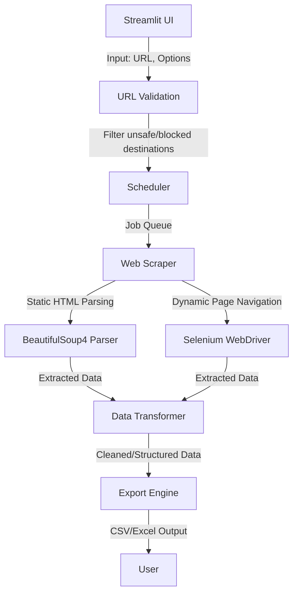

# my_crawler


## 🚀 Executive Summary

`my_crawler` is a robust, secure, and modular web scraping tool built with Python 3.9+, Streamlit, Selenium, and BeautifulSoup4. Designed for reliable data extraction, it adheres to privacy, security, and ethical web scraping best practices, providing a streamlined and scalable interface for structured data export in formats like CSV and Excel. From static HTML scraping to fully browser-driven automation, `my_crawler` empowers users to navigate intricate web pages with confidence.

## ✨ Key Features

- **Modular Design**: Decoupled components for fetching, parsing, transforming, and exporting data ensure testability and scalability.
- **SSRF Protection**: Strict URL validation and blocking of unsafe network destinations, including loopback, private, and metadata-service addresses.
- **Compliance Ready**: Respects `robots.txt`, terms of service, rate limits, and data privacy standards, minimizing legal and ethical liabilities.
- **Timeouts & Backoff**: Configurable connection, page-load, script execution, and full job runtime limits, paired with bounded retries and exponential backoff.
- **Sandboxed Selenium**: Minimally permissive browser configuration with controlled memory, page limits, and download restrictions for safe execution.
- **Dynamic & Static Scraping**: Seamless integration of browser-driven scraping (via Selenium) and lightweight static HTML parsing (via BeautifulSoup4).
- **Export Flexibility**: Outputs scraped data to structured formats like CSV and Excel for downstream analysis.
- **Thorough Testing**: Fixture-based tests for malformed HTML, redirect loops, encoding issues, dynamic content, and bot detection ensure reliability.

## 🏛️ Architecture & Workflow



## 🧰 Tech Stack & Tools Breakdown

| Component                | Technology/Tool         | Purpose                                                                 |
|--------------------------|-------------------------|-------------------------------------------------------------------------|
| **Frontend**             | Streamlit              | User-friendly interface for defining scraping jobs                      |
| **Web Scraping**         | BeautifulSoup4         | Fast and efficient parsing of static web pages                         |
|                          | Selenium               | Browser-driven automation for handling JavaScript-heavy pages           |
| **Data Handling**        | Pandas                 | Data transformation and manipulation                                   |
| **Export**               | CSV, Excel            | Data export to widely used structured formats                          |
| **Testing**              | Pytest + Fixtures      | Thorough coverage for edge cases like redirects, bot blocks, etc.      |

## ⚡ Quickstart / Installation

Follow these steps to set up and run `my_crawler` on your system.

### Prerequisites

- Python 3.9 or later
- ChromeDriver or an equivalent browser driver (matching your browser version)

### Installation

1. **Clone the Repository**
   ```bash
   git clone https://github.com/EF361/my_crawler.git
   cd my_crawler
   ```

2. **Set Up Virtual Environment**
   ```bash
   python3 -m venv venv
   source venv/bin/activate  # On Windows: venv\Scripts\activate
   ```

3. **Install Dependencies**
   ```bash
   pip install -r requirements.txt
   ```

4. **Download Appropriate Browser Driver**
   - Ensure the browser driver version matches your installed browser.
   - [ChromeDriver Downloads](https://sites.google.com/chromium.org/driver/)

5. **Run the Streamlit Application**
   ```bash
   streamlit run app.py
   ```

### Configuration

- **Browser Driver Path**: Update the `.env` file with the path to your browser driver.
- **Timeouts & Retries**: Customize these parameters in the `config.py` file to fit your needs.

### Testing

Run tests to ensure the scraper is functioning as expected:

```bash
pytest tests/
```

## 📜 License

This repository is licensed under the MIT License. See the [LICENSE](LICENSE) file for details.

---

Made with ❤️ by [EF361](https://github.com/EF361).